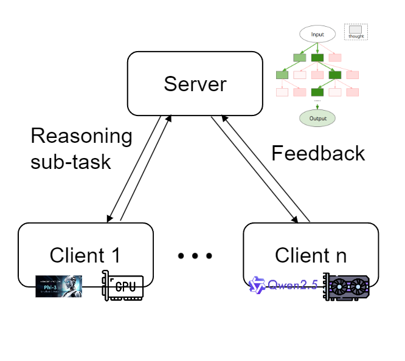

# Federated Monte Carlo Tree Search for Large Language Model Inference

<p>
    <a href="https://badge.fury.io/py/tree-of-thoughts-llm">
        
    </a>
    <a href="https://www.python.org/">
        
    </a>
    <a href="https://copyright.princeton.edu/policy">
        
    </a>
</p>




## Introduction

### Acknowledgment

This repository is based on the foundation of [Tree of Thoughts: Deliberate Problem Solving with Large Language Models](https://proceedings.neurips.cc/paper_files/paper/2023/file/271db9922b8d1f4dd7aaef84ed5ac703-Paper-Conference.pdf), whose official repository is [https://github.com/princeton-nlp/tree-of-thought-llm](https://github.com/princeton-nlp/tree-of-thought-llm). Thanks for their high-quality codes!

### Demo

A demo for this work is comming soon.

### Background

Yao et al.'s work demonstrates the potential of the Monte Carlo Search Tree (MCST) method in solving problems like 24-point, crossword puzzles, and creative writing. This method achieves remarkable results in tasks requiring deep thought by exploring multiple reasoning paths and evaluating them with the model. They propose a reasoning framework called Tree-of-Thought (ToT), which decomposes problems into intermediate steps ("thoughts"), generates multiple possible solutions at each step, screens out the most promising paths through self-evaluation, and combines strategies like breadth-first search (BFS) or depth-first search (DFS) for systematic exploration and backtracking. This helps language models find optimal solutions to complex problems and significantly enhances their reasoning and planning abilities.

While the MCTS method has made significant progress in tasks like 24-point that require deep thought, it is computationally expensive because it needs to generate and evaluate multiple thoughts. For example, solving a 24-point task with GPT-4o alone consumes thousands to tens of thousands of tokens. Moreover, when using smaller models, the accuracy of the MCTS method drops significantly, similar to the Chain-of-Thought (CoT) method. In CoT reasoning, smaller models have weaker generation capabilities and struggle to produce diverse and high-quality intermediate steps. In the MCTS method, smaller models also face limitations in evaluation capabilities, making it difficult to achieve usable performance.

To address these issues, we propose the Federated MCTS method, a plug-and-play reasoning framework that supports joint reasoning by models of different scales. We noticed that the insufficient evaluation capabilities of smaller models are particularly prominent in the MCTS method, limiting their further application in MCTS. With our method, we achieved accuracy comparable to pure large models in the 24-point task while significantly reducing costs compared to pure large models. Specifically, we made the following modifications:

- **Rule-enhanced Evaluation**: During evaluation, we assist the process with rules. We summarized some cases that can obviously complete 24-point, such as 1, 1, 1, 24 or 1, 1, 1, 8. When these cases are matched, they are assigned higher evaluation scores.

- **Format Verification**: To ensure the accuracy of evaluation, we verify the thought format during generation, ensuring that all thoughts entering the evaluation have the correct format. During the generation phase, if a thought does not have the correct format, it will be discarded.

- **Prompt Learning**: We adopted a different Prompt from the original ToT method, which significantly improved the accuracy.

- **Federated Reasoning**: Federated Reasoning: We adopt a federated reasoning approach, which allows one or multiple distinct models to collaboratively participate in the reasoning process for the same task.


## Method

The steps of our method is the same as the original Tree-of-Thought framework, which are **decomposition, generation, evaluation, and selection**. For the 24-point task, we use breadth-first search while searching in the Monte Carlo tree. Like the original work, our work consists of a tree, whose node is a state $s=[t_i, z_1, ..., z_{n-1}]$ representing a partial solution with the input and the sequence of thoughts so far.

### 1. Decomposition: 
For each 24-point task $t_i$, each decomposition $z_j$ of $t_i$ is a line matching the pattern "number operator number = result (left: remaining numbers)" like
```plaintext
8 - 1 = 7 (left: 1 1 7)
```

### 2. Generation: 

(1) Task Assignment: For state $s$ and model list $[m_1, ..., m_m]$, task assignment decomposes $s$ into a list of $s_1, ..., s_m$, and assign $s_l$ to model $m_l$.

$$
s_1, ..., s_m = \rm{TaskAssign}(s, m)
$$
   
Where function $\rm{TaskAssign(·)}$ decomposes $s=[t_i, z_1, ..., z_{n-1}]$ to $s_r=[t_i, z_s, ..., z_t]$, where $t - s + 1 = \lfloor \frac{n-1}{m} \rfloor$.

Specially, if $s=[t_i]$, i.e. there is no "thought" generated yet, initial generation will be used on the first model $m_1$, which is

$$
z_1, ..., z_k = G(s, p_{\theta}^{\rm{propose}}, k, m_1)
$$

Where thought generator $G(·)$ is introduced in the following paragraph.

(2) Thought Generation: For each state $s$, generation strategy $p_e$, candidates number $k$ and generation model $m$, thought generator $G(s, p_e, k, m)$ generates $k$ candidates using the language model $m$. For the generation strategies, there are two strategies: sample and propose. 

    (a) Sample: 
    (b) Propose: 

Considered the thought space in 24-point task is more constrained, we use propose strategy, which is formalizedly presented as: 

$$
[z^{(1)}, ..., z^{(k)}] \sim p_{\theta}^{\rm{propose}}(z^{(1...k)}_{i+1}|s)
$$

Thoughts generated by model $m_i$ is:

$$
T_i = G(s, p_{\theta}^{\rm{propose}}, k, m_i)
$$

(3) Format Verification: For each $z_j$, check whether it has the same format like the example hereinbefore.

$$
T_i' = \{ z_j \in T_i | \rm{FormatCheck}(z_j)=True \}
$$

Where FormatCheck($z_j$)=True if $z_j$​ matches the pattern "number operator number = result (left: remaining numbers)" otherwise​ False.

(4) Thought Aggregation: Due to the thoughts $T_i$ is generated on different models, it is necessary to aggregate all the result, i.e.

$$
T= \cap_{i} T_i
$$


### 3. Evaluation

(1) Strategies of Evaluation:

    (a) Vote: 
    (b) Value: 

(2) Evaluation Task Assignment: Given the state $s$, model list $m_1, m_q$ (Where $q$ can be different to $m$ hereinafter). 

(3) Assigning Score to each $z_j$

(4) Rule-Enhanced Evaluation:
## Expriments

## Results

## Installation

The runnable package is `federated_mcts` (version `0.2.0`), built from the
`src/` layout. Python 3.10 or newer is required.

```bash
# HTTP/API runs: no torch or transformers are installed or imported.
pip install -e .

# Local vLLM inference and DQN search need the optional ML backends.
pip install -e ".[local]"
```

`src/tot/` is kept in the checkout as legacy reference material. It is **not**
part of the distribution; setuptools is configured to package only
`federated_mcts`, and `MANIFEST.in` carries only `src/federated_mcts/data`.
The HTTP model clients, Game24 runner, and experiment runner must remain
importable without `torch` or `transformers`.

For a source checkout without installation, put `src` on `PYTHONPATH`:

```bash
PYTHONPATH=src .venv/bin/python -m federated_mcts --help
```

## Usage

The canonical entry points are:

| Entry point | Equivalent | Purpose |
| --- | --- | --- |
| `python -m federated_mcts` | `fmcts-run` | Run one search experiment. |
| `fmcts-exp` | `python -m federated_mcts.experiments.sweep` | Historical Game24 sampling sweep. |

Run one experiment from a source checkout:

```bash
PYTHONPATH=src .venv/bin/python -m federated_mcts \
  --task game24 \
  --task_start_index 0 --task_end_index 3 \
  --model_config configs/model_config_vllm.json \
  --solve_method tot \
  --method_generate propose \
  --method_evaluate vote \
  --method_select greedy \
  --n_generate_sample 2 \
  --n_evaluate_sample 3 \
  --n_select_sample 2 \
  --temperature 0.9 \
  --check_format
```

Useful safety/output options:

- `--dry_run` resolves flags, task IDs, the model config, the manifest, and the
  projection without creating output files, clients, or making API calls.
- `--mock_client` uses the deterministic offline Game24 client; it still goes
  through the normal solver constructor and search path.
- `--resume` continues a run only when the journal's `run_fingerprint` matches;
  without it, an existing output prefix is rejected, never overwritten.
- Outputs are written under `logs/<task>/<solve_method>/<remote_model>/` as
  `<prefix>_manifest.json`, `<prefix>.json`, `<prefix>_performance.json`,
  `<prefix>_journal.json`, and `<prefix>_budget.jsonl`. The prefix ends in
  `_ntasks{N}`. Equal-size task sets can share a prefix; use a different
  `--inference_idx` for a different run rather than overwriting earlier evidence.

New runs use schema-v2 manifests, including all resolved decision options and
an explicit mock/real distinction. Historical v1 evidence remains readable and
verifiable, but cannot authorize a v2 validation run: generate a new v2 pilot.
Game24 audited/full validation currently requires baseline `tot` telemetry.
DQN checkpoint identity follows file contents, not the filename. Execution rejects
changes since preparation, and the loader verifies the exact bytes it deserializes.

### Internal boundaries

- [DecisionSpec](<src/federated_mcts/config.py>) is the immutable source for search
  options and decision identity; model configuration is resolved once per run.
- [Experiment runner](<src/federated_mcts/experiments/runner.py>) separates read-only
  `prepare()` from `execute()`, which owns authorization, clients, usage and commits.
- [FederatedSolver](<src/federated_mcts/federation/orchestrator.py>) accepts injected
  clients. [finish_task](<src/federated_mcts/federation/outcome.py>) verifies the
  outcome before publishing the DQN terminal transition.
- [Observation protocols](<src/federated_mcts/core/observation.py>) keep search
  primitives independent of concrete Game24 telemetry recorders. Evaluation caches
  are isolated by task/input, client instance and evaluator identity.
- [Usage scopes](<src/federated_mcts/models/usage.py>) isolate concurrent runs;
  [RateCard](<src/federated_mcts/models/rates.py>) supplies shared Decimal pricing.
- [TaskCommitter](<src/federated_mcts/evaluation/game24_persistence.py>) orders
  durable outcome → keyed charge → settled outcome. Evidence verification uses a
  separate read-only ledger parser, never a writable ledger constructor.

Recovery settles a durable task outcome and its exact Decimal charge at most
once. An interrupted API call with no metered outcome is deliberately **not**
automatically replayed: its usage is unknown and needs manual reconciliation.
Run artifacts have a single-writer contract. Call/token caps are checked at task
boundaries, not inside a model request. Selected-test authorization stays
one-shot; `--resume` does not reauthorize a consumed selected-test attempt.

`fmcts-exp` preserves the historical sampling sweep. Its phase-2 non-`tot`
Game24 configs over more than 20 tasks are rejected by the current runner
safety gate; update the experiment design before reusing that phase.

The pre-refactor layout is gone. In particular:

| Removed | Replacement |
| --- | --- |
| root `run.py`, root `merged_run.py`, root `exp.py` | `python -m federated_mcts` / `fmcts-run` (search) and `fmcts-exp` (sweep). |
| `scripts/run.py`, `scripts/merged_run.py`, `scripts/exp.py` | The same canonical module entry points; the run lifecycle lives in `federated_mcts.experiments.runner`, and sweep lives in `federated_mcts.experiments.sweep`. |
| `scripts/game24/*.sh`, `scripts/text/*.sh`, `scripts/crosswords/*.sh`, `scripts/gsm8k/*.sh` recipes tied to the deleted scripts | The two recipes that remain were converted to `python -m federated_mcts`; incompatible ones were deleted with reasons in [`scripts/README.md`](scripts/README.md). |

The runner keeps the same experimental parameters and environment handling as
the retired scripts: model configuration, credentials, task range/split, solver
knobs, and output location are still explicit inputs, and no recipe silently
substitutes a model or algorithm.

## Testing

```bash
PYTHONPATH=src RUN_LIVE_DEEPSEEK_DIAGNOSTIC=0 \
  .venv/bin/python -m unittest discover -s tests -p 'test_*.py'
```

Tests are offline by default. The live DeepSeek diagnostic is opt-in through
`RUN_LIVE_DEEPSEEK_DIAGNOSTIC=1` and is never required by the suite.

## Small Talk
