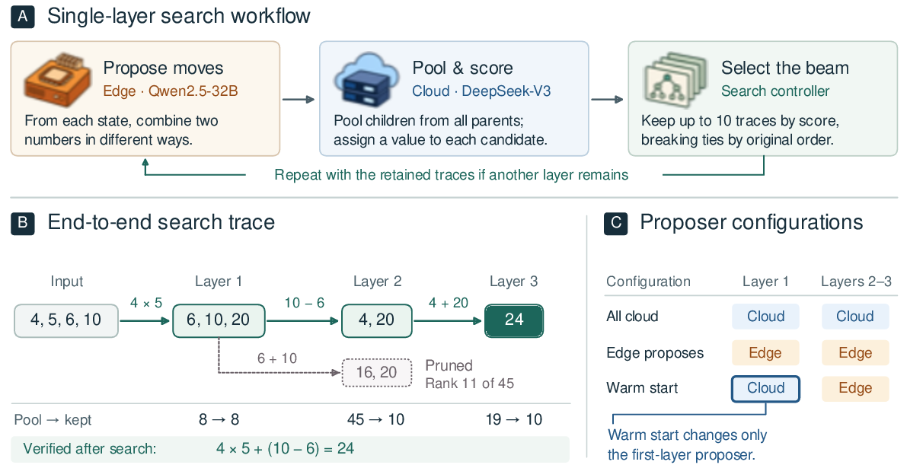

# JointToT: Allocating Cloud Calls in Tree-of-Thought Search

JointToT asks where a cloud model is worth using: to **propose** the next reasoning step, or to **score** steps proposed by a smaller model. This repository contains the search code and the evidence behind the working paper. On 30 Game24 puzzles, using the cloud to propose only the first layer reduced **estimated cloud charges by 39.45%** relative to all-cloud search; it solved 25 puzzles rather than 26. A separate comparison suggests a cheaper baseline worth trying first: generate several complete answers and check them.

[Run one puzzle offline](#quickstart) · [Results](#results) · [English experiment section (PDF)](experiments/jointtot_202611/paper/JointToT-experiments.pdf) · [Experiment guide / 中文复现说明](experiments/jointtot_202611/README.md)

## How it works

In Game24, a state is the multiset of numbers still available. For each retained path, the proposer combines two numbers. Candidates from **all** parents are pooled and scored; the controller keeps up to the beam width for the next layer. In the [trace shown above](experiments/jointtot_202611/paper/figure-workflow/trace.json), two moves from `{6, 10, 20}` were legal. The branch starting with `10 − 6` went on to reach `4 + 20 = 24`. The branch starting with `6 + 10` ranked 11th and missed the beam of ten. Final arithmetic verification is separate from the model score.

The paper studies **layered beam search**, not Monte Carlo rollouts or federated training. The distribution is still named `federated-mcts` (v0.2.0); its Python module is `federated_mcts`.

## Results

**Does splitting the work reduce cloud use?** We rechecked the saved paths for the same [30 Game24 puzzles](experiments/jointtot_202611/archive_game24/README.md) (IDs 900–929). A puzzle counts as solved if **any** of its final ten retained paths verifies, not necessarily the first. DeepSeek-V3 scored candidates in all three runs; the edge proposer was Qwen2.5-32B-Instruct.

| Who proposes? | Solved / 30 | Cloud calls | Estimated cloud fee (CNY, all 30) |
| --- | ---: | ---: | ---: |
| Cloud at every layer | 26 | 3,447 | 2.136 |
| Edge at every layer | 23 | 1,467 | 1.326 |
| Cloud at layer 1, then edge (warm start) | 25 | 1,444 | 1.293 |

Warm start solved one puzzle the all-cloud run missed and missed two that it solved. The fees use historical token rates, not invoices; they exclude local inference, and the runs have no comparable latency measurements. This is not evidence of equal accuracy or lower total deployment cost.

| Further comparison | What the records show |
| --- | --- |
| [Complete answers vs. search](experiments/jointtot_202611/sampling/README.md) · archival, 148 other Game24 puzzles | Ten DeepSeek-V3 answers per puzzle, checked by an arithmetic verifier, solved **130/148**; the all-cloud tree solved **132/148**. The tree cost **8.34×** as much at historical rates (CNY 10.93 vs. 1.31). Budgets were not matched. |
| [Branch selection](experiments/jointtot_202611/replay/README.md) · replay, 200 validation puzzles | Of 118 second-layer pools with a path still capable of reaching 24, the original selector kept such a path in **51**; dropping unchanged states and merging duplicates kept one in **57**. No new continuations were generated: these are not six extra solved puzzles. |
| [Evaluator size](experiments/jointtot_202611/local_judge/README.md) · **new local inference**, 20 of those 200 puzzles | Given four choices per puzzle, Qwen2.5-7B and 32B picked a viable first choice **8/20 vs. 15/20** times. Reversing the same choices gave **12/20 vs. 12/20**. |
| [GSM8K grading](experiments/jointtot_202611/gsm8k/README.md) · archival, 50 matched questions | The old grader favored the split (all-cloud **40/50**, split **42/50**); a fixed exact-number rule reversed the ranking (**42/50**, **40/50**). The split used **19.33% fewer tokens** across both models. |

The Game24 sampling, replay and evaluator studies require nonnegative integer intermediate results and exact division. Their metrics and puzzle sets differ; do not pool them into a single win rate. The open question is what an extra cloud call buys **at the same budget**: another proposal, a complete answer, or a better ranking.

## Quickstart

From the repository root, install with **Python 3.10+**. The default installation is sufficient for the offline demo and HTTP clients; it does not require PyTorch, Transformers, or a GPU.

~~~bash
python3 -m venv .venv
. .venv/bin/activate
python -m pip install -e .
python -m federated_mcts --help
~~~

Run **one Game24 puzzle** using a deterministic mock client. No API key, model download, or service is needed after installation. The [demo configuration](examples/mock-game24.json) uses loopback addresses; the model names are for configuration and accounting only.

~~~bash
python -m federated_mcts --task game24 \
  --task_start_index 3 --task_end_index 4 \
  --solve_method tot --method_generate propose --method_evaluate vote \
  --method_select greedy --n_select_sample 2 \
  --model_config examples/mock-game24.json --mock_client
~~~

The half-open range selects only puzzle 3. The runner writes its trace, performance summary, manifest, journal and budget ledger under `logs/game24/tot/deepseek-v4-flash/`. Add `--dry_run` to inspect the plan without creating outputs; choose a new `--inference_idx` for a fresh run, or use `--resume` with a matching fingerprint. The mock exercises the search code, **not** the accuracy, API charges, or end-to-end routing in the paper.

## Reproduce the checks

From a source checkout with the experiment artifacts, these commands check the rendered tables and re-score the saved local evaluator outputs. Neither command calls a model or downloads weights.

~~~bash
D=experiments/jointtot_202611
python3 -B "$D/paper/render.py" --check
python3 -B "$D/local_judge/verify.py" --check
~~~

For per-puzzle records, scoring rules, paired comparisons and instructions for rebuilding from raw archives, see the [experiment guide](experiments/jointtot_202611/README.md). Full archival reconstruction needs the files and, in some cases, Git objects identified there; the Python package alone is not the artifact bundle.

## Running and developing the code

- **Entry points.** `fmcts-run` is equivalent to `python -m federated_mcts`. `fmcts-exp` (or `python -m federated_mcts.experiments.sweep`) is a historical sweep, not an offline demo. Its non-`tot` phase over more than 20 Game24 puzzles is blocked by the current validation gate. The [script migration notes](scripts/README.md) cover the retired `run.py`, `merged_run.py` and `exp.py` entry points.
- **Live runs.** Use your own endpoint configuration and credentials, not the demo file; [the environment template](.env.example) lists the variables. Check the [runner's client selection](src/federated_mcts/experiments/runner.py) and [solver routing](src/federated_mcts/federation/standard_solvers.py) before spending a budget: the current baseline runner explicitly supplies a remote proposer when present. The `speculative_solve` flag alone does not reproduce the historical split. Optional local ML backends use `python -m pip install -e ".[local]"`; this does not launch a model server.
- **Outputs and recovery.** A [run manifest](src/federated_mcts/experiments/runner.py) records resolved options and whether clients were mocked. Keep one writer per prefix. Call/token caps are checked between tasks; an interrupted call with unknown usage requires reconciliation, not an automatic retry. Historical v1 manifests remain readable but cannot authorize full v2 Game24 validation: run a new baseline `tot` pilot. Resuming does not renew one-shot test authorization.
- **Source layout.** [`src/federated_mcts/`](src/federated_mcts/) is the installed package. [`src/tot/`](src/tot/) is the historical implementation, kept for reference and excluded from the distribution. [`tests/`](tests/) covers the current runner, search and accounting.

For the full test suite, install `.[local]` first (some tests import PyTorch). Run from the repository root with the live diagnostic disabled:

~~~bash
PYTHONPATH=src RUN_LIVE_DEEPSEEK_DIAGNOSTIC=0 \
  python -m unittest discover -s tests -p 'test_*.py'
~~~

## Acknowledgments and license

JointToT builds on Yao et al., [*Tree of Thoughts: Deliberate Problem Solving with Large Language Models*](https://arxiv.org/abs/2305.10601) ([upstream code](https://github.com/princeton-nlp/tree-of-thought-llm)). The code is distributed under the [MIT License](LICENSE); the upstream copyright notice is retained.
